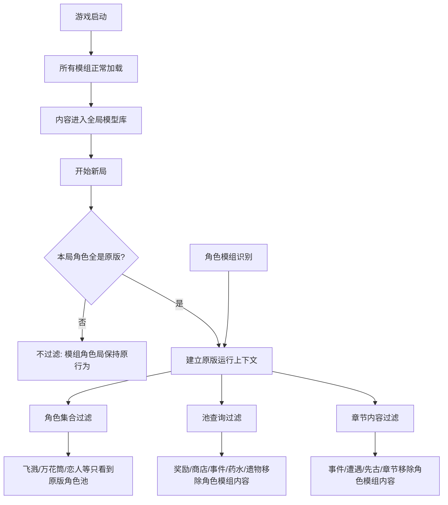

# 001-R 角色模组隔离可行性调研

- 调研时间：2026-11-17 02:16
- 调研方式：只读。读反编译源码、上游模组源码、已安装模组清单与清单文件；未启动游戏，未写游戏目录。
- 目标：判断「角色模组保持启用，但游玩原版角色时其新增内容不出现」是否可行，并给出实现路径。

## 一、结论

**可行，置信度高，但边界明确。**

对按标准方式注册内容的第三方角色模组，可以在运行期按「本局角色集合」过滤其内容。角色模组仍加载，选人界面仍可选；选原版角色时，该模组新增的卡牌、遗物、药水、事件、遭遇、先古、章节不进入本局内容。选该模组角色时，内容恢复。纯卡牌、纯遗物等非角色模组内容继续出现。

角色模组识别以 `ModelDb.AllCharacters` 为主要证据：非游戏程序集角色按程序集归属到模组，该模组即角色模组。未注册角色类作为补充证据；无法判断时，用户可切换到手动选择模式。手动模式完全跳过自动识别，只隔离勾选模组。非角色模组内容不进入隔离范围。

不能保证的部分：

- 角色模组如果直接 Harmony 补丁原版卡牌、原版遗物、原版事件或「飞溅」实现，这些补丁仍生效。
- 角色模组如果绕过内容池，直接向奖励候选或战斗生成注入卡牌，标准过滤器可能看不到。可选严格模式能覆盖一部分，但不是绝对。
- 已有存档中的模组内容不会被删除。
- 多人模式默认不启用，避免玩家配置不同导致状态发散。

## 二、现状：为什么关掉模组要重启

游戏启动时 `ModManager.Initialize` 读取 `mods/` 与 Steam 创意工坊，加载每个模组的 `<mod_id>.dll`，调用 `[ModInitializer]`。DLL 加载后无法卸载；内容池在首次访问后缓存。因此「按局启用/禁用模组」在现有加载器上做不到。

角色模组通常通过 `ModHelper.AddModelToPool` 把自定义卡牌、遗物、药水加入池。池被访问时把模组类型拼接到原版列表，之后缓存。原版角色生成奖励时读取这些池，就会看到模组内容。

「飞溅」是一个直接例子：它读取 `Owner.UnlockState.CharacterCardPools`，对每个角色池调用 `GetUnlockedCards`，再从中挑攻击牌。只要角色模组的角色在已解锁角色列表里，它的卡池就参与候选。

## 三、方案总览

不做「卸载模组」，做「运行期内容视图」。先识别角色模组，再做三层过滤：

### 3.1 角色集合过滤

补丁 `UnlockState.Characters` 的 getter。原版局把角色模组角色从结果里移除。`CharacterCardPools` 由 `Characters` 派生，因此「飞溅」「恋人」「万花筒」「ocarina」「BottledSong」「Orobas」「Blitz 商店」等读取角色集合的效果自动只看到原版角色。

副作用：`Kaleidoscope.IsAllowedAtNeow` 用「角色卡池数 == 全部角色数」判断是否给遗物。过滤后两边口径不一致，需要单独修正为「过滤后的角色卡池数 == 过滤后的角色数」。

### 3.2 池查询过滤

卡牌补丁 `CardPoolModel.GetUnlockedCards`。它是非虚方法，所有池共用，补丁基类即可。

遗物与药水补丁所有具体池的 `GetUnlockedRelics` / `GetUnlockedPotions` 实现，外加基类。原因：这两个方法是虚方法，原版各池都重写，且多数重写不调用基类。只补丁基类不会生效。运行时枚举 `RelicPoolModel` / `PotionPoolModel` 的全部具体类型（含模组池），逐个补丁其声明实现。

规则：

- 池本身属于角色模组：返回空。防止角色模组池里塞原版内容。
- 原版池里混入角色模组内容：移除该内容；非角色模组内容保留。
- 角色模组局：不过滤。

这些方法是绝大多数奖励、商店、事件、变形、发现、药水生成、遗物抓袋的公共出口。

### 3.3 章节内容过滤

- 遭遇：`ActModel.AllEncounters` 及其弱/普通/精英/Boss/怪物派生 getter 后置过滤。每个 getter 单独过滤，避免规范实例的缓存被可变实例继承后绕过过滤。
- 事件：`ModelDb.AllSharedEvents` 与各具体 `ActModel.AllEvents` 后置过滤；`ActModel.PullNextEvent` 前置兜底。
- 先古：`ModelDb.AllSharedAncients`、各具体 `ActModel.AllAncients`、`GetUnlockedAncients` 后置过滤；`GenerateRooms` 前置清理 `_sharedAncientSubset`，后置兜底替换仍被选中的模组先古。
- 章节：`ModelDb.ActsByIndex` 后置过滤；过滤后空桶用同索引原版默认章节补齐或删除，避免「无可用章节」异常；`StartRunLobby.BeginRunLocally` 前置建立「待定上下文」，因为章节列表在 `RunManager.State` 建立前选择；`ActModel.GetRandomList` 后置兜底替换已选中的模组章节。

## 四、「飞溅」的具体链路

`Splash.OnPlay`（0.113.1，`MegaCrit.Sts2.Core.Models.Cards/Splash.cs:25-33`）：

1. 取 `Owner.UnlockState.CharacterCardPools`。
2. 多于一个池时移除自己角色的池。
3. 对每个池调用 `GetUnlockedCards`，只留攻击牌。
4. `CardFactory.GetDistinctForCombat` 抽 3 张。
5. 玩家选 1 张，免费打出。

隔离后：

- 角色集合过滤把模组角色移出 `Characters`，`CharacterCardPools` 只剩原版池。
- 即使某个模组池仍在列表里，池查询过滤会把它清空。
- 两条路都保证候选只有原版攻击牌。

不需要重写 `Splash.OnPlay`。这比整段替换方法更稳，避免跟随游戏版本改实现。

## 五、模组角色为什么仍然可玩

- 选人界面读取 `ModelDb.AllCharacters` 建按钮，本模组不补丁它。
- 角色按钮的解锁判定读 `UnlockState.Characters`；本模组只在局内过滤，局外返回原集合，因此模组角色不会被锁。
- 开始角色模组局后，本局角色集合包含模组角色，运行上下文判定为「不隔离」。
- 角色集合、池查询、章节过滤全部放行，角色模组内容按原行为出现。
- 纯内容模组在原版局也不被隔离；它没有角色，不属于角色模组。

## 六、版本兼容

目标 0.107.1、0.111.0、0.113.1。单程序集方案的前提是运行期只调用三版签名一致的成员。已核对的成员见 [003-E](003-E-三版本API对照.md)。

主要差异与处理：

| 差异 | 处理 |
|---|---|
| `Mod.assembly`（107）与 `Mod.assemblies`（111+） | 反射读字段，不直接引用 |
| `ModelDb.AllCharacters` 5/5/6 个 | 不硬编码数量，按类型归属判断 |
| `ActModel.GenerateRooms` 重载差异 | 按版本补丁存在的重载：107/111 三参，113 四参；不直接调用 |
| `GameMode` 113 新增 Dread/Blitz | 不引用新枚举值 |
| `Fool`、`FoolCardPool`、`CardTag.Shoot` 只在 113 | 不引用 |
| 0.107.1/0.111.0 程序集未留存 | 单程序集不需要旧版编译；旧版运行验证另做 |

## 七、边界与不能做的事

1. **代码补丁不可隔离。** 角色模组如果 Harmony 补丁 `Splash.OnPlay`、原版卡牌数值、原版遗物逻辑，过滤内容池不会撤销补丁。
2. **非池注入不可完全覆盖。** 如果模组直接后置补丁奖励候选或战斗生成，标准池过滤看不到。可选严格模式在 `CardCreationOptions.GetPossibleCards` 与 `CardFactory` 出口再过滤，但可能减少候选数量，默认关闭。
3. **已有存档不清理。** 旧局里的模组卡牌保留；只影响新生成。
4. **多人默认关闭。** 候选列表变化会改变随机数消耗；玩家本地设置不同步。默认关闭，避免状态发散。
5. **图鉴不隐藏。** v1 只隔离局内生成，不隐藏主菜单图鉴与卡牌库。
6. **角色模组局不隔离其他模组。** 默认「只要本局有模组角色就不过滤」。更严格的「只启用本角色所属模组」会破坏跨模组内容，v1 不做。
7. **角色模组识别可能有歧义。** 共用程序集、未注册角色或动态加载可能无法自动归属；用户可切换到手动选择模式；未知默认不隔离。

## 八、落地步骤

1. 建工程与清单；确认 RitsuLib 依赖。
2. 内容归属：程序集 → 模组 ID；类型缓存。
3. 运行上下文：`RunManager.DebugOnlyGetState()` + 玩家角色。
4. 角色集合过滤与 Kaleidoscope 修正。
5. 卡牌/遗物/药水池过滤。
6. 事件/遭遇/先古/章节过滤与兜底。
7. 设置页、日志、失败降级。
8. 三版本验收。

详细补丁表见 [2.PLANS/004-M-过滤补丁族.md](../2.PLANS/004-M-过滤补丁族.md)。

## 九、验证状态

- 已验证（静态）：内容注册、池查询、角色集合、「飞溅」、事件/遭遇/先古/章节链路均能在反编译源码中定位。
- 已验证（静态）：LinkuraMod 使用 RitsuLib `[RegisterCharacter]` 与 `[RegisterCard]`，内容类型来自模组程序集。
- 未验证（运行）：未启动游戏；未做端到端隔离测试。
- 未验证（旧版）：0.107.1、0.111.0 只有反编译源码，没有程序集与实际运行环境。
- 未确认：真实第三方角色模组是否全部走标准注册；需要拿具体模组做运行测试。

## 十、证据索引

- [002-E 内容注册与生成链路](002-E-游戏内容注册与生成链路取证.md)
- [003-E 三版本 API 对照](003-E-三版本API对照.md)
- [004-E 第三方角色模组实现方式](004-E-第三方角色模组实现方式取证.md)
- [005-R 方案对比与风险](005-R-方案对比与风险.md)
