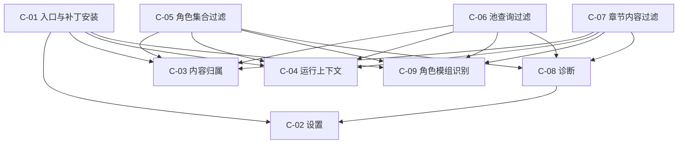

# 001 总体设计草案

- 状态：实现中；0.2.0 已实现。0.3.0 计划加入「当前角色模组保护集」，尚未施工。
- 建立：2026-11-17 02:16
- 项目版本：0.2.0（0.3.0 计划）
- 关联：[ADR-001](../4.ADR/001-按运行角色隔离模组内容.md)、[ADR-003](../4.ADR/003-内容归属按程序集映射.md)、[ADR-004](../4.ADR/004-过滤在池查询与内容消费两端布防.md)、[ADR-010](../4.ADR/010-保护当前角色模组并隔离其他模组.md)、[隔离行为规范 v0.6](../6.SPEC/001-隔离行为规范-v0.6.md)、[ADR-007](../4.ADR/007-按已注册角色识别角色模组.md)

> 本文对应 0.2.0 实现；0.3.0 保护集方案已纳入设计，尚未施工。未实现或未验证的内容在「实现状态」与「偏差与限制」中标明。

## 一、上下文与范围

系统是一个 STS2 模组，运行在游戏进程内。它不新增内容，只改变原版角色局的内容视图。隔离对象仅限角色模组的内容；非角色模组内容放行。

范围：

- 识别角色模组与模组内容；
- 自动模式下识别角色模组；手动模式下由用户勾选，跳过自动识别；
- 判定本局是否隔离；
- 在卡池、遗物池、药水池、章节内容出口过滤；
- 提供设置、日志、失败降级。

不负责：

- 加载/卸载模组；
- 修改存档结构；
- 隔离模组对原版代码的补丁；
- 隐藏图鉴 UI；
- 多人配置同步。

## 二、架构总览



## 三、组件分解

| 编号 | 组件 | 计划符号/文件 | 职责 | 不负责 |
|---|---|---|---|---|
| C-01 | 入口与补丁安装 | `src/Plugin.cs`、`src/Patches/PatchRegistry.cs` | 初始化日志、设置、归属、补丁；按类别处理补丁失败 | 具体过滤规则 |
| C-02 | 设置 | `src/ModSettings.cs` | 总开关、分类开关、自动/手动隔离来源、自动检测清单、手动勾选列表、详细日志；持久化 | 运行判定 |
| C-03 | 内容归属 | `src/Runtime/ContentOwnership.cs` | 程序集→模组映射；类型→归属缓存；未知程序集策略 | 角色模组分类、本局是否隔离 |
| C-04 | 运行上下文 | `src/Runtime/RunContext.cs` | 读取本局角色；计算当前角色所属模组、保护集、隔离集、策略版本；单人/多人；缓存判定 | 角色模组分类、内容过滤细节 |
| C-05 | 角色集合过滤 | `src/Patches/CharacterPatches.cs`、`src/Patches/ActPatches.cs` | 局内移除隔离集角色；保护当前角色所属模组；Kaleidoscope 修正 | 卡池内容 |
| C-06 | 池查询过滤 | `src/Patches/PoolPatches.cs` | 卡牌基类查询 `GetUnlockedCards` 与 `AllCards` 源数组双层过滤；遗物/药水基类与具体重写；只过滤隔离集内容 | 章节内容 |
| C-07 | 章节内容过滤 | `src/Patches/ActPatches.cs`、`src/Patches/SpecialPatches.cs` | 遭遇/事件/先古/章节列表过滤与兜底；Orobas 局部角色列表 | 卡牌/遗物/药水 |
| C-09 | 角色模组识别 | `src/Runtime/CharacterModRegistry.cs` | 只枚举已启用模组；自动模式读取已注册角色、扫描角色类、映射模组；手动模式把勾选集合视为角色模组，不启动自动识别 | 本局是否隔离、具体过滤规则 |
| C-08 | 诊断 | `src/Diagnostics/FilterLog.cs` | 结构化日志、限流、计数 | 业务判定 |

## 四、依赖与分层

允许：

- C-01 → C-02、C-03、C-04、C-05、C-06、C-07、C-09
- C-05/C-06/C-07 → C-03、C-04、C-02、C-08、C-09
- C-03 → `ModManager`、`Mod`、反射
- C-09 → C-03、`ModelDb`、`ModContentRegistry`、反射
- C-04 → `RunManager`、`RunState`、`Player`

禁止：

- C-03 → C-04/C-05/C-06/C-07
- C-04 → C-05/C-06/C-07
- C-09 → C-05/C-06/C-07
- C-05/C-06/C-07 → 具体模组类型、具体角色类型、具体卡牌 ID
- C-09 → 具体角色类型（只能反射/类型判断，不写死名字）
- 任何组件 → 游戏目录写操作

静态检查方式：

- 编译期命名空间分层检查；
- 代码评审搜索 `BaseLib`、`Fool`、`CardTag.Shoot`、`GameMode.Blitz`、硬编码模组 ID；
- 运行日志检查未知程序集。

## 五、数据设计

```csharp
enum ContentOrigin { Vanilla, Framework, Mod, Unknown }

sealed class ContentOwnership {
    ContentOrigin GetOrigin(Type type);
    string? GetOwnerModId(Type type);
    void EnsureBuilt();
}

enum IsolationSource { Auto, Manual }
enum CharacterModKind { Character, LikelyCharacter, NotCharacter, Unknown }

sealed class CharacterModRegistry {
    IsolationSource Source { get; }
    void EnsureBuilt();
    CharacterModKind GetAuto(string modId);
    bool IsCharacterMod(string modId);
    void SetManualSelection(IEnumerable<string> modIds);
}

sealed class RunContext {
    bool IsActive { get; }
    bool IsMultiplayer { get; }
    string? Reason { get; }
    string? CurrentCharacterOwner { get; }
    IReadOnlySet<string> ProtectedModIds { get; }
    IReadOnlySet<string> IsolatedModIds { get; }
    int PolicyVersion { get; }
    bool IsIsolatedOwner(string modId);
    bool IsIsolatedOwnerForActs(string modId);
    bool IsProtectedOwner(string modId);
    void EnsureForCurrentRun();
    void Clear();
}
```

不写入存档。所有状态是进程内缓存；局结束或状态读取失败时清空。

## 六、内部接口

| 接口 | 输入 | 输出 | 失败行为 |
|---|---|---|---|
| `ContentOwnership.GetOrigin(Type)` | 模型类型 | 归属枚举 | 返回 Unknown，日志一次 |
| `CharacterModRegistry.IsCharacterMod(string)` | 模组 ID | 是否为角色模组 | Unknown 默认 false；手动模式只认勾选集合 |
| `CharacterModRegistry.GetAuto(string)` | 模组 ID | 自动分类与依据 | Unknown；禁用模组返回 Unknown；手动模式不得调用 |
| `CharacterModRegistry.IsModEnabled(...)` | Mod 或模组 ID | 是否已启用 | 关闭的模组为 false |
| `CharacterModRegistry.IsDetectedCharacterMod(string)` | 模组 ID | 自动模式是否识别为角色模组 | 手动模式为 false |
| `RunContext.IsActive` | 无 | 隔离集是否非空且可启用 | false |
| `RunContext.IsolatedModIds` | 无 | 本局隔离集 `I` | 空集合 |
| `RunContext.ProtectedModIds` | 无 | 本局保护集 `P` | 空集合 |
| `RunContext.CurrentCharacterOwner` | 无 | 当前角色所属模组 `O` | null |
| `RunContext.IsIsolatedOwner(string)` | 模组 ID | 模组是否在 `I` 中 | false |
| `RunContext.IsIsolatedOwnerForActs(string)` | 模组 ID | 章节待定阶段是否在 `I` 中 | false |
| `FilterPolicy.ShouldIsolateOwner(Type)` | 内容类型 | 是否属于本局隔离集 | false |
| `FilterPolicy.ShouldFilter(ContentCategory)` | 类别 | 是否过滤该类别 | false |
| `FilterLog.Removed(category, count)` | 类别/数量 | 日志 | 吞掉日志异常 |

## 七、关键流程

### 7.0 隔离来源

1. C-02 读取互斥模式：自动识别或手动选择。
2. **手动模式**：C-09 直接读取勾选列表，不读取 `ModelDb.AllCharacters`，不扫描 `CharacterModel`，不构建自动分类。勾选集合视为角色模组集合 `C`。未勾选模组不进入 `C`。勾选为空时不隔离。
3. **自动模式**：所有模组加载完成后，C-09 只读取已启用模组，再读取 `ModelDb.AllCharacters`；禁用模组不进入扫描、缓存或日志。自动识别结果构成 `C`。
4. 非游戏程序集角色按程序集映射到模组；该模组标为「已注册角色」。
5. 补充扫描模组程序集中的具体 `CharacterModel` 子类；未注册的标为「可能角色」，默认按角色模组处理。
6. 没有角色的模组标为「非角色模组」；归属失败标为「未知」。
7. 未知默认不隔离，设置页显示警告；日志列出自动依据与未知项。
8. 两种模式的结果都按模组 ID 缓存；手动模式不产生自动分类日志。
9. 设置页自动区只显示已启用且被识别为角色模组的条目；状态由 `RunContext` 与当前分类动态计算；手动区只列已启用模组。
10. C-04 读取当前角色所属模组 `O`，计算 `P = {O}` 与 `I = C − P`。原版角色 `P` 为空，`I = C`。

### 7.1 开局

1. C-01 安装补丁。
2. 玩家选人；C-04 不活跃，选人界面显示全部角色。角色按钮的解锁判定也读 `UnlockState.Characters`（`NCharacterSelectButton.Init`）；因此过滤器只能在局内启用，局外必须返回原集合，否则角色模组角色会被锁。
3. `StartRunLobby.BeginRunLocally` 前置：C-04 读取 `Players` 建立待定上下文。
4. `ActModel.GetRandomList`：C-07 按待定上下文过滤章节；之后清除待定上下文。
5. `RunManager.SetUpNew*` 建立 `RunState`。
6. C-04 读取玩家角色；单机、总开关开、角色可解析、`I` 非空 → 活跃。原版角色 `O = null`，`P = ∅`，`I = C`；角色模组 A 时 `P = {A}`，`I = C − {A}`。

### 7.2 「飞溅」

1. `Splash.OnPlay` 取 `CharacterCardPools`。
2. C-05 已移除 `I` 中的角色模组角色；当前角色模组 A 与原版角色保留。
3. 若其他角色模组池仍在，C-06 在 `AllCards` 源数组移除 `I` 中的卡，`GetUnlockedCards` 再兜底。
4. 原版局候选只含原版攻击牌；角色模组 A 局候选含原版攻击牌，不含其他角色模组攻击牌。A 自身卡池按飞溅原规则排除。

### 7.3 奖励/商店

1. `CardCreationOptions.GetPossibleCards` 或 `MerchantInventory` 调 `GetUnlockedCards`。
2. C-06 在 `AllCards` 源数组与 `GetUnlockedCards` 出口过滤 `I` 中的卡；源数组过滤覆盖可能绕过查询后置的调用点。
3. `PotionFactory`/`RelicGrabBag` 调对应池查询；C-06 只过滤 `I` 中的遗物与药水。
4. 原版内容、非角色模组内容与当前角色模组 A 的内容不受影响。

### 7.4 事件/遭遇/先古/章节

1. `ActModel.GenerateRooms` 取 `AllEvents`/`AllSharedEvents`/`AllEncounters`/`GetUnlockedAncients`/`_sharedAncientSubset`。
2. C-07 在各出口只过滤 `I` 中的内容；当前角色模组 A 与原版内容保留；`PullNextEvent` 兜底。
3. `ModelDb.ActsByIndex` 过滤章节。
4. 待定阶段使用 `PendingProtected` 与 `PendingIsolated`，不得读取上一局集合。

### 7.5 读档

1. `RunState.FromSerializable` 恢复玩家与已有内容。
2. C-04 读取角色并计算 `O`、`P`、`I`；已有模组内容保留。
3. 新生成内容按当前局隔离集过滤；旧内容不删除、不替换。

## 八、状态与生命周期

| 状态 | 建立 | 清除 | 说明 |
|---|---|---|---|
| 归属映射 | 首次过滤/开局 | 进程结束 | 模组加载后不再变化 |
| 隔离来源与集合 | 设置读取/首次查询 | 进程结束 | 自动识别结果（仅启用），或已启用手动勾选集合 |
| 当前角色归属 | 运行上下文求值 | 局结束/状态读取失败 | `O`；原版角色为 null |
| 保护集与隔离集 | 运行上下文求值 | 局结束/状态读取失败 | `P`、`I`；`I` 为空时不启用 |
| 策略版本 | 运行上下文求值 | 进程结束 | 每次 `P`、`I`、`O` 变化时递增 |
| 角色模组分类 | 所有模组加载后 | 进程结束/手动重新检测 | 仅自动模式构建；只含已启用模组 |
| 已启用模组集合 | 首次检测/重新检测 | 进程结束/重新检测 | 模组清单与启用状态 |
| 待定上下文 | `BeginRunLocally` 前置 | `GetRandomList` 后 | 保存待定 `P`、`I`、`O`；只用于章节选择 |
| 运行上下文 | 首次查询 | 局结束/状态读取失败 | 缓存本局判定与策略版本 |
| 卡池源缓存 | 首次进入隔离局并读取 `AllCards` | 策略版本或设置版本变化 | 按卡池实例缓存过滤后的 `CardModel[]`；不改写原池缓存 |
| 设置快照 | 设置变更/首次读取 | 进程结束 | 版本号失效 |

## 九、失败与降级

- 归属失败：Unknown，不自动隔离；日志一次，设置页提示切换手动选择模式。
- 角色模组识别失败：不自动隔离；用户可切换到手动模式，不阻断游戏。
- 当前角色归属无法解析：不启用隔离；不得按原版角色处理。
- 手动模式未勾选任何模组：不隔离。
- `I` 为空：不启用过滤；当前角色内容保留。
- 上下文失败：不隔离。
- 核心补丁失败：整体关闭隔离；设置页显示未生效。
- 分类补丁失败：只关闭该分类。
- 过滤异常：返回原结果；日志限流。
- 旧存档：不清理内容。
- 多人：默认不隔离。
- 随机角色：保持不启用；章节待定阶段不猜测归属。

## 十、资源与构建

- 单程序集；`mod_manifest.json`；可选本地化文件。
- 编译基线 0.113.1；`min_game_version` 0.111.0。
- 不写游戏目录；构建脚本只在部署时复制到 `mods/<id>/`。
- 版本号五处一致：程序集、文件、清单、文件名、ChangeLog。
- 性能目标：启动额外开销不超过 200 毫秒；单次内容查询不超过 0.1 毫秒；详细日志关闭。
- 性能记录与测量方法见 `3.DOCS/007-R-性能影响预估.md`。

## 十一、需求追溯

| 需求 | 组件 | 规范 |
|---|---|---|
| RQ-002/003/004 | C-06、C-07、C-09 | SP-017 至 SP-033 |
| RQ-005 | C-05、C-06、C-09 | SP-014 至 SP-016、SP-020 |
| RQ-006 | C-04、C-09 | SP-088、SP-093、SP-095、SP-096 |
| RQ-007 | C-04 | SP-086、SP-097、SP-101 至 SP-104 |
| RQ-008 | C-02、C-09 | SP-047 至 SP-054、SP-082、SP-089、SP-108、SP-110、SP-111 |
| RQ-009 | C-01、C-03 | SP-058 至 SP-063 |
| RQ-010 | C-04 | SP-008 |
| RQ-011 | C-06、C-07 | SP-002 |
| RQ-012 | C-01、C-08 | SP-040 至 SP-043 |
| RQ-013 | C-03、C-09 | SP-034 至 SP-039、SP-072 |
| RQ-014 | C-08 | SP-055 至 SP-057 |
| RQ-019 | C-09、C-02 | SP-082、SP-089、SP-108、SP-110、SP-111 |
| RQ-020 | C-02、C-08 | SP-107、SP-109、SP-112 |
| RQ-022 | C-04、C-05、C-06、C-07、C-09 | SP-081 至 SP-130 |

## 十二、偏差与限制

- 0.2.0 已实现自动/手动识别、卡牌/遗物/药水/遭遇/事件/先古/章节过滤、设置页与日志；自动模式只显示已启用角色模组及其过滤状态。
- 0.2.0 的模组角色局仍为「不隔离」。0.3.0 计划改为保护当前角色所属模组、隔离其他角色模组；代码尚未修改。
- 0.3.0 的 `SourceCache` 必须按策略版本失效；现有 0.2.0 缓存只按源数组引用判断。
- 0.113.1 完整原版局已胜利；卡牌过滤覆盖 `AllCards` 源数组与 `GetUnlockedCards`；Token 池 50→39、分类覆盖 0。
- 0.107.1 不支持；0.111.0 无独立运行环境，实测基线为 0.111.1。
- 严格生成出口过滤、多人开启开关与工坊上传不在当前范围。
- 不隔离代码补丁；不隐藏图鉴；不清理旧存档；不隐藏选人界面角色。
- 章节待定上下文对随机角色不精确；随机角色局可能包含角色模组章节。此限制待运行验证后决定是否修正。
- 当前角色内容若由其他模组 ID 拥有，保护集会不完整；P0 审计未通过时不得进入施工验收。
- 角色模组与纯内容模组共用程序集时，自动归属可能不唯一；需要手动选择模式。
- 未注册角色类只作为推测证据；用户可以关闭该模组的角色分类。

## 十三、变更记录

| 时间 | 变更 |
|---|---|
| 2026-11-17 02:16 | 建立草案 |
| 2026-11-17 03:05 | 增加 C-09 角色模组识别；过滤对象改为角色模组内容 |
| 2026-11-17 03:30 | 隔离来源改为自动/手动互斥；手动模式跳过自动识别 |
| 2026-11-17 04:55 | 对应 0.1.0 实现：补丁注册、动态池/章节补丁、设置页、Orobas 局部作用域；记录加载验证状态 |
| 2026-11-17 20:30 | 0.2.0：只检测已启用模组；自动模式检测清单与过滤状态；兼容目标改为 111/113 |
| 2026-11-18 01:05 | 卡牌源级过滤：`AllCards` 与 `GetUnlockedCards` 双层；0.113.1 Token 池 50→39 |
| 2026-11-23 02:45 | 纳入 0.3.0 设计：当前角色所属模组保护集、其他角色模组隔离集、手动勾选语义、策略版本缓存与待定章节策略 |


## 十四、实现状态

| 项 | 状态 | 证据 |
|---|---|---|
| 0.113.1 主菜单加载 | 通过 | `8.TEST/0.1.0/2026-11-17-1131-主菜单加载与51补丁.log` |
| 手动模式跳过自动识别 | 通过 | `8.TEST/0.1.0/2026-11-17-手动模式-51补丁.log` |
| 自动识别真实角色模组 | 通过 | MGRMod 启用后 `character=1`；见 `8.TEST/0.1.0/2026-11-17-MGR启用-自动识别.log` |
| 0.2.0 原版角色内容过滤 | 通过 | 0.113.1 完整局 victory；0.111.1 飞溅专项 0 模组；见 009-M |
| 0.3.0 当前角色保护集 | 未开始 | 计划 010-M；代码未修改 |
| 模组角色局保护行为 | 未验证 | 旧 0.2.0 为模组角色局不隔离；0.3.0 待施工 |
| 0.107.1 | 不支持 | 兼容范围已放弃 |
| 0.111.0 精确版本 | 未验证 | 无独立运行环境；实测基线为 0.111.1 |
